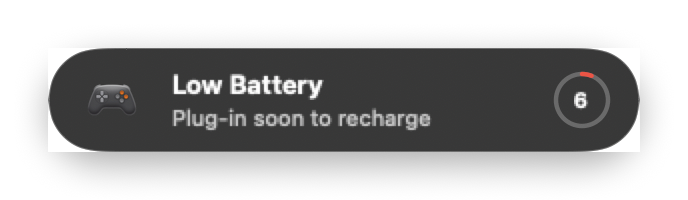
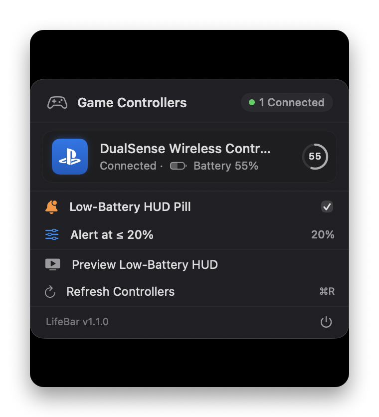

<p align="center">
  
</p>

<h1 align="center">LifeBar</h1>

<p align="center">
  <strong>Never let your controller die mid-game.</strong><br/>
  Native macOS menu bar battery monitor & low-battery HUD for PlayStation DualSense, Xbox, Nintendo Switch, and MFi controllers.
</p>

<p align="center">
  <a href="https://github.com/passs0/LifeBar/releases/latest"></a>
  
  
  <a href="LICENSE"></a>
</p>

<p align="center">
  
  <br/><br/>
  
</p>

---

> [!NOTE]
> **AI-Generated Project Disclosure**
> **LifeBar** (including its Swift architecture, `GameController` observation, non-activating HUD panel, and Apple HIG squircle icon) is an **AI-generated project** created with **Antigravity** (Google DeepMind).

---

## Features

- **Menu Bar Status Item (`LSUIElement`):** Sits quietly in your menu bar using Apple's `gamecontroller` SF Symbol with optional live percentage display, hover tooltip, and zero Dock clutter.
- **Broad Controller Support:** Uses `GameController.framework` for PlayStation (DualSense, DualSense Edge, DualShock 4), Xbox (Wireless, Elite Series 2), Nintendo (Switch Pro, Joy-Cons), and MFi/HID gamepads.
- **Non-Activating Low-Battery HUD:** Floating frosted capsule (`NSPanel`) with Apple's circular gauge ring, alert sound, and Notification Center mirroring that never steals focus from full-screen games.
- **Smart Threshold & System Integration:** Configurable 5%–35% alert threshold, one-click test button, Launch at Login (`SMAppService`), and automatic refresh on system wake.

## Installation

### Download Release
1. Download **`LifeBar-v1.1.1.dmg`** from [GitHub Releases](https://github.com/passs0/LifeBar/releases/latest) and drag **`LifeBar.app`** to `/Applications`.
2. On first launch, right-click `LifeBar.app` ➔ **Open**, or run `xattr -cr /Applications/LifeBar.app`.

### Build from Source
```zsh
git clone https://github.com/passs0/LifeBar.git && cd LifeBar
make install
```

## License

Released under the [MIT License](LICENSE).
