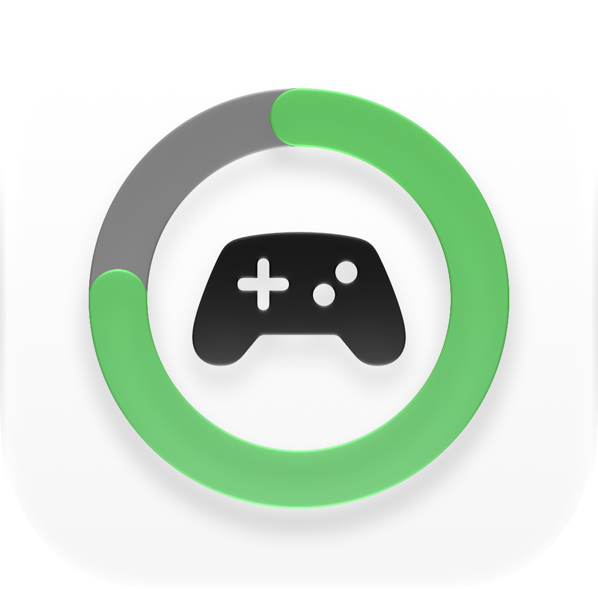
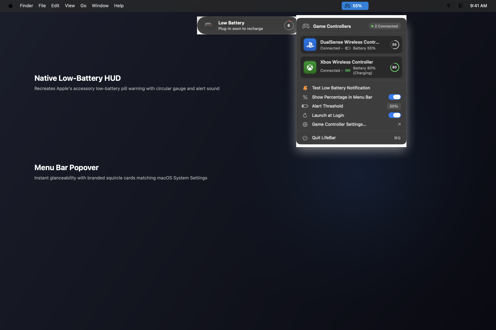

<p align="center">
  
</p>

<h1 align="center">LifeBar</h1>

<p align="center">
  <strong>Never let your controller die mid-game.</strong><br/>
  Native macOS menu bar battery monitor & accessory low-battery HUD for PlayStation DualSense, Xbox, Nintendo Switch, and MFi controllers.
</p>

<p align="center">
  <a href="https://github.com/passs0/LifeBar/releases/latest"></a>
  
  
  <a href="LICENSE"></a>
</p>

<p align="center">
  
</p>

---

> [!NOTE]
> **AI-Generated Project Disclosure**
> **LifeBar** (including its Swift architecture, GameController framework observation, AppKit non-activating HUD panel, reverse-engineered macOS accessory battery notification layout, and Apple HIG dark mode squircle icon) is an **AI-generated project** created with **Antigravity** (Google DeepMind).

---

## ✨ Why LifeBar?

macOS displays a brief system pill banner when a game controller connects via Bluetooth, but **it provides no persistent menu bar battery monitor and never alerts you when your controller battery drops dangerously low during a game**.

To check your battery level, you usually have to leave your game, open **System Settings**, navigate to the **Game Controllers** pane, and squint at the subline. When the battery runs out, the controller simply shuts off mid-action without warning—costing you a boss fight or clutch multiplayer round.

**LifeBar solves this with pure macOS first-party polish:**
- **Instant Menu Bar Glanceability:** Sits quietly in your menu bar using Apple's official SF Symbol `gamecontroller` glyph, with optional live percentage display and zero Dock clutter (`LSUIElement`).
- **macOS System Settings Aesthetics:** Pops open a clean, native card list matching macOS Sequoia/Sonoma System Settings, featuring branded PlayStation, Xbox, and Nintendo squircle badges.
- **Apple Accessory Low-Battery HUD Notification:** Recreates Apple's exact floating frosted-glass accessory low-battery pill banner (with circular gauge, red progress arc, and alert sound) whenever your controller drops to 20% (or your chosen threshold).

---

## 🚀 Features

### 1. Menu Bar Status Item (Zero Dock Clutter)
- Uses Apple's official SF Symbol `gamecontroller` glyph with automatic Dark/Light menu bar template adaptation.
- Highlights with macOS's native accent selection pill while the menu is open (`NSPopoverDelegate`).
- Runs as a lightweight macOS agent app (`LSUIElement = true`) with **0% background CPU overhead**.
- Optional toggle to display the battery percentage directly in the menu bar next to the icon.
- Hover tooltip showing all connected controllers and their individual battery percentages.

### 2. System Settings-Style Controller List
- Uses Apple's `GameController.framework` (`GCController`) for reliable detection of wireless (Bluetooth) and wired game controllers:
  - **Sony PlayStation:** DualSense, DualSense Edge, DualShock 4 (branded Sony Blue squircle with `playstation.logo`).
  - **Microsoft Xbox:** Xbox Wireless Controller, Xbox Elite Series 2 (branded Xbox Green squircle with `xbox.logo`).
  - **Nintendo:** Switch Pro Controller, Joy-Cons (branded Nintendo Red squircle).
  - **MFi & HID Gamepads:** 8BitDo, Backbone One, Razer, SteelSeries, etc.
- Displays connection status, live battery level, charging indicators (`⚡️ Battery 55% (Charging)`), and visual progress badges.

### 3. Native Low-Battery HUD Notification Banner
- Recreates Apple's native accessory low-battery pill alert:
  - **Floating Frosted Capsule:** Borderless, non-activating `NSPanel` floating smoothly at the top of your screen below the notch/menu bar.
  - **Built-in Controller Glyph:** Uses Apple's official 3D controller asset (`Generic-GameController.png` from `CoreBluetoothUI`).
  - **Apple Circular Gauge Ring:** Circular track, remaining battery arc in red, and centered battery percentage number in SF Pro Rounded.
  - **Audio & System Integration:** Accompanied by macOS alert sound (`Sosumi`) and mirrored to macOS Notification Center.
- **Smart Deduplication:** Alerts once per discharge cycle; will not spam repeatedly while in the low-battery state.
- **One-Click Test:** Includes a **"Test Low Battery Notification"** button to preview the exact HUD alert anytime.

### 4. Deep System Integration & Convenience
- **Customizable Threshold:** Choose your alert threshold (10%, 15%, 20%, or 25%).
- **Quick Settings Access:** One-click shortcut jumping directly to the macOS Game Controllers settings pane.
- **Launch at Login:** Native integration with Apple's modern `SMAppService` API.
- **Sleep & Wake Resilient:** Automatically refreshes connections and polling upon system wake.

---

## 📦 Installation & Getting Started

### Recommended: Pre-Built Release

1. **Download the App**:
   Go to the [**Releases**](https://github.com/passs0/LifeBar/releases/latest) page and download **`LifeBar-v1.1.0.zip`**.
2. **Move to Applications**:
   Unzip the archive and drag **`LifeBar.app`** into your **`/Applications`** folder.
3. **First-Launch Gatekeeper Clearance (macOS)**:
   Because the app is ad-hoc signed, run the following command once in Terminal (or right-click -> **Open** in Finder) to clear the macOS quarantine attribute:
   ```bash
   xattr -cr /Applications/LifeBar.app
   ```
4. **Launch & Connect**:
   - Open **`LifeBar`** from Applications, Spotlight, or Launchpad.
   - Pair or turn on your game controller — the battery level will appear instantly in your menu bar!

---

## 🛠️ Architecture & Under the Hood

```
LifeBar/
├── Package.swift                               # Swift package definition (macOS 13+)
├── Info.plist                                  # Bundle configuration (LSUIElement = true)
├── Makefile                                    # Convenient build & install targets
├── build.sh                                    # Release packaging & ad-hoc codesigning script
├── generate_icns.sh                            # Multi-resolution Retina AppIcon compiler
├── assets/
│   └── icon.png                                # macOS Sequoia Dark Mode vector app icon
└── Sources/
    └── LifeBar/
        ├── main.swift                          # Main entry point & NSApplication lifecycle
        ├── AppDelegate.swift                   # NSStatusItem & NSPopover coordinator
        ├── ControllerManager.swift             # GameController observation & battery monitoring
        ├── ControllerModel.swift               # Brand detection, SF Symbols & battery formatting
        ├── MenuView.swift                      # SwiftUI popover matching System Settings
        ├── LowBatteryHUDController.swift       # Floating NSPanel HUD presentation & animation
        └── LowBatteryHUDView.swift             # Frosted glass capsule & circular gauge view
```

- **`GCController` Lifecycle:** Listens to `.GCControllerDidConnect` and `.GCControllerDidDisconnect` notifications, coupled with low-frequency (6s) battery polling that incurs zero perceptible system load.
- **Non-Activating HUD Window:** `LowBatteryHUDController` manages an `NSPanel` with `.nonactivatingPanel` and collection behavior `[.canJoinAllSpaces, .fullScreenAuxiliary]`, ensuring full-screen games never lose focus when the low-battery warning appears.

---

## ⌨️ Building from Source

Ensure you have **Xcode Command Line Tools** and **Swift 5.9+** installed:

```bash
# Clone the repository
git clone https://github.com/passs0/LifeBar.git
cd LifeBar

# Build the release app bundle
make app

# Run the app
make run

# Install to /Applications
make install
```

---

## 📄 License

This project is licensed under the [MIT License](LICENSE).
